# GEV System Delivery: AI-assisted RCAs, incident patterns and one place to work from

> Turn ServiceNow incidents into root cause analyses, spot the problems that keep coming back and see the hours they cost.
> Private LLM on your own GPU. Ticket data stays on the company network. A person approves every RCA.

      

> **Status.** The front end is built and runs on sample data. The FastAPI backend, the agents, vLLM serving, the LoRA adapter and the ServiceNow and Box connections are designed but not built yet. Every "works today" claim below is about the UI on mock data. Sources: `docs/PRD.md`, `docs/architecture/`, `docs/adr/`.

## How it works, end to end

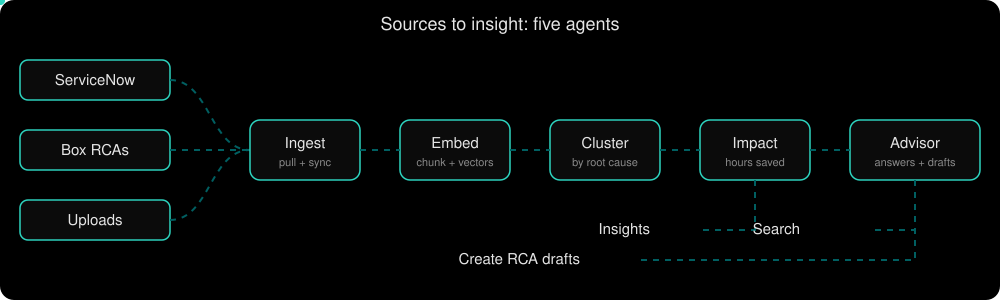

1. **Sync.** A background worker pulls resolved incidents from ServiceNow, RCA Word documents from Box and uploaded files into PostgreSQL. Pages never call ServiceNow or Box live.
2. **Understand.** Five agents run in order: Ingest, Embed, Cluster, Impact, Advisor. Incidents are chunked, embedded into pgvector, grouped by root cause and costed in hours.
3. **Show.** Insights shows recurring root causes and the hours a permanent fix would save. Search finds similar incidents and who fixed them.
4. **Draft.** For an incident with no RCA, the Advisor drafts one in the team's exact template using retrieved incidents as context and a Llama 3.1 model with a LoRA adapter that has learned the RCA style.
5. **Approve.** The engineer completes what only they know and approves. Only then is the `.docx` uploaded to Box, which feeds Search and Insights again.

| Target deployment | This repository today |
|---|---|
| Four on-prem VMs: app, database, Redis, GPU | Next.js UI on your machine |
| FastAPI + LangGraph agents + worker | Mock backend in `src/lib/mock.ts` |
| Llama 3.1 on vLLM with a LoRA adapter, embeddings in pgvector | Rule-based drafts and scripted agent answers |
| Real ServiceNow and Box connections | Connect and sync screens on sample data |

## Results at a glance

| UI pages | Agents | Endpoints in the contract | ADRs | RCA template sections | Internet needed for ticket data |
|---|---|---|---|---|---|
| 8 plus build release | 5 | 18 route groups (`docs/PRD.md` §7) | 26+ | 6, never reordered | none, on-prem |

Model quality numbers do not exist yet, because nothing is trained or served. The evaluation plan and the table that will hold them are in [Fine-tuning](#fine-tuning-lora).

## The two problems it solves

**Problem 1: fragmentation.** The team uses about 30 tools that live as browser bookmarks. There is no onboarding, Box is used like SharePoint, and simple facts have nowhere to live, for example "on what date was this environment last restored from a snapshot?".

**Problem 2: missing RCAs, unseen patterns.** Not every incident has an RCA. Years of history sit in a spreadsheet nobody has used. Some RCAs exist as Word files in Box. Different people fix tickets with the same root cause, so nobody sees the pattern or what it costs.

| Problem | What the app does |
|---|---|
| Fragmentation | Homepage widgets, a Tools launcher with Chrome-importable bookmark export, an Environments snapshot tracker with Log latest and Notify manager |
| Missing RCAs | AI-drafted RCAs in the exact template, Word editor, `.docx` export, upload to Box after approval |
| Unseen patterns | Embedding and clustering by root cause, hours spent and hours savable, interactive charts, an agent that explains any chart |

## Highlights

| | |
|---|---|
| Directed AI search | Pick the task (similar incidents, who resolved them, root causes, suggest a fix), filter by date, project, source, status and resolver, and get an answer with scored related incidents |
| One-click RCA | Pre-filled from ServiceNow. The form only asks for what ServiceNow cannot know: 5 Whys, mitigation, corrective actions, screenshots |
| Chart to agent | Click any bar, slice or cell, choose Ask agent, and the sidebar opens tagged with that item and its numbers |
| Private model | Llama 3.1 on vLLM inside the network. No ticket data goes to a hosted API unless security approves |
| Fixed template | The RCA is a Pydantic model, so every section is returned, in order |
| Human approval | A LangGraph interrupt waits for the engineer. Nothing reaches Box without it |
| Resilient | Timeouts, egress rate limits and circuit breakers on every external call. Pages keep working if ServiceNow, Box or the GPU is down |

## Pages

| Page | Route | What it gives |
|---|---|---|
| Homepage | `/` | Widgets the user adds or removes: environment snapshots, incident patterns, tool shortcuts, incident trend, Ask the agent |
| Environments | `/environments` | PD1, PD2, MPR1, MPR2: snapshot, who applied it, when, up to date or stale, **Log latest**, **Notify manager** |
| Tools | `/tools` | Links in folders (Admin, Training, Working, Location, Tools), search, **Export bookmarks** |
| Build Release | `/build-release` | Progress trackers for PD1, PD2, MPR1 with a ticket page each |
| RCA Insights | `/rca/insights` | Summary figures, five-agent strip, high-priority clusters, six interactive charts |
| Create RCA | `/rca/create` | Incident list with combined filters, **Edit RCA info**, **View Word**, **Edit Word**, **Upload to Box** |
| RCA Search | `/rca` | Directed search with filters, related incidents with match score, follow-up chat |
| Data sources | `/rca/upload` | Drop files, connect ServiceNow and Box, **Sync now**, **Disconnect** |
| Settings | `/admin` | Line manager and notification toggles |
| Agent sidebar | any page | Advisor chat, taggable with a cluster or chart item, streams, can be stopped |

<details>
<summary>Page details: Insights, Create RCA, Search, Data sources</summary>

**Insights.** Summary figures are incidents, hours spent, average resolution time and hours that could be saved. Charts: incidents per month with average hours, hours spent versus savable per cluster, root cause donut, subsystems by severity, cluster trend over time, and a resolution-time heatmap. Clusters can be filtered by severity and sorted.

**Create RCA.** Lists ServiceNow incidents by date with number, description, priority, opened, resolved, time taken, assignee and RCA status (Needs RCA, Draft, In Box). Filters combine and take several values: status, priority, assignee, time taken and opened date. **Edit RCA info** opens the form beside the list, pre-filled with problem statement, impact, timeline, service restoration, root cause code and investigation. A "to do" counter shows what is left. A full-page version exists at `/rca/create/[number]`.

**Search.** Task buttons, free text, optional attached logs or tickets, and filters for date range (30 days, 90 days, past year, all time), project, source (ServiceNow, Box, uploads), status and resolved by.

**Data sources.** Each upload shows processing, indexed or failed. Connections discover their own scope, show the account, last sync and record count, and offer Sync now and Disconnect.

Full spec: `docs/PRD.md` §5.
</details>

## The RCA template

Exactly as the team uses it. Sections are never renamed, reordered or added to (`docs/PRD.md` §6).

| Section | Content |
|---|---|
| Header | Root Cause Analysis (RCA) Report, Problem Number, Problem Statement (title) |
| Problem Statement | Problem Statement, Business Impact |
| Investigation | Timeline, Investigation, Service Restoration, Next Steps |
| Root Cause | Root Cause Code (from ServiceNow), Root Cause Details (5 Whys; a trigger such as capacity is not the root cause) |
| Mitigation | Preventive actions, plan if in progress, workaround, or why there is no solution |
| Corrective Actions | Table of Number, Action, Owner, Due Date, State (6 rows) |

## One RCA, from ticket to Box

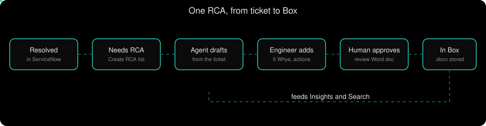

### Backend RCA flow, step by step

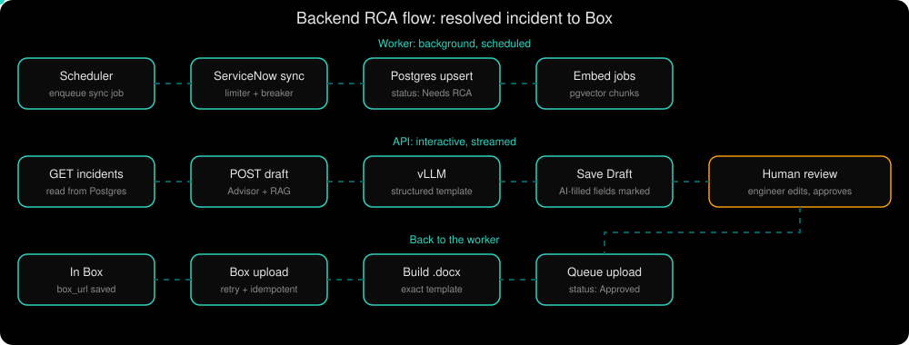

1. **Sync (worker).** A scheduler enqueues a job. The worker pulls resolved incidents from ServiceNow through the egress limiter and circuit breaker and upserts them into Postgres as **Needs RCA**, then queues embed jobs.
2. **List (API).** `GET /rca/incidents` reads Postgres, never ServiceNow.
3. **Draft (API, streamed).** `POST /rca/reports/{n}/draft` runs the Advisor with RAG. The model returns every template section as Pydantic structured output, and the draft records which fields the AI filled.
4. **Review (human).** The engineer edits and must approve. A LangGraph interrupt waits here, and who approved and when is saved.
5. **Upload (worker).** Approval saves the RCA to Postgres first and queues the upload. The worker builds the `.docx` and uploads it to Box with retries and an idempotency key, so a retry never creates a duplicate. The status becomes **In Box**.

Source: `docs/architecture/flows.md` (a). Where the `.docx` is built is still TODO there.

### RCA status lifecycle

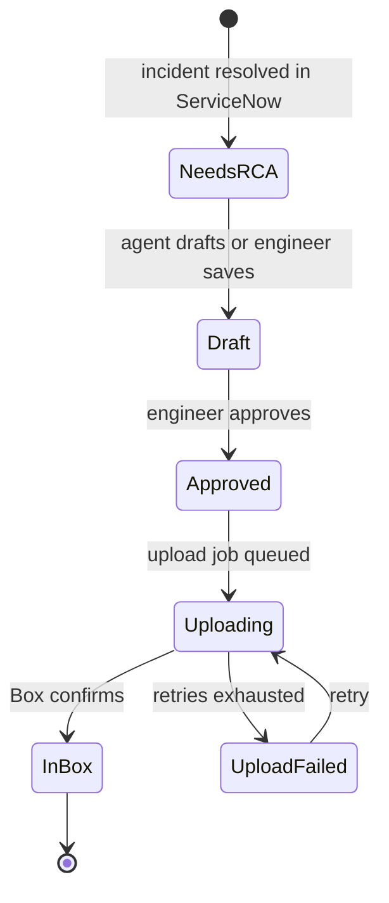

## Dashboard flow

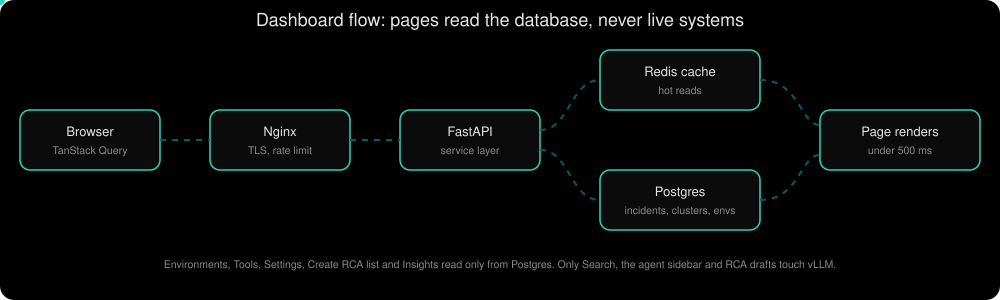

| Page | Reads from |
|---|---|
| Environments, Tools, Settings | Postgres |
| Create RCA list | Postgres, synced from ServiceNow |
| Insights | Postgres: clusters and impact written by the agents |
| Search, agent sidebar, RCA draft | pgvector retrieval plus vLLM |

Dashboards read only from Postgres and Redis, so they stay under the 500 ms target even when the reasoning plane is slow or down.

## Architecture

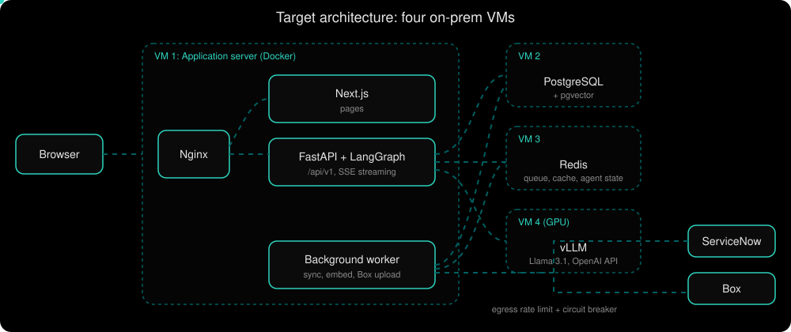

| VM | Runs |
|---|---|
| 1 Application | Nginx, Next.js, FastAPI with the LangGraph agents, background worker, all in Docker |
| 2 Database | PostgreSQL with pgvector |
| 3 Redis | Job queue, cache, agent state |
| 4 AI model | vLLM serving Llama 3.1 and the LoRA adapter on the GPU |

| Plane | Lives there | Why separate |
|---|---|---|
| Presentation | Browser, Nginx, Next.js | Changes with design. Never holds credentials |
| Reasoning | FastAPI services, LangGraph agents, worker, vLLM | The slow, failure-prone part |
| Data | PostgreSQL + pgvector, Redis | Durable and fast. Dashboards read only from here |

Request path: browser to Nginx (TLS, rate limit) to Next.js for pages and FastAPI under `/api/v1` for data, then a service reads Postgres, Redis or vLLM. Streamed answers use SSE. See `docs/architecture/high-level.md`.

## The five agents

Agents are LangGraph nodes with typed state, a recursion limit, a timeout per node and bounded retries. State lets work loop back, branch, and pause for approval.

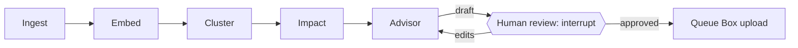

| Agent | LLM? | What it does | Runs in | Writes |
|---|---|---|---|---|
| Ingest | No | Fetches ServiceNow, Box and uploads and normalises them | Worker | Incidents, uploads, sync status |
| Embed | Embedding model only | Chunks text, embeds it, stores vectors with model name and version | Worker | Chunks, embeddings |
| Cluster | Only to name clusters | Groups incidents by root cause with a clustering algorithm (TODO) | Worker | Clusters, `incident.cluster_id` |
| Impact | No | Hours spent and hours savable per cluster (formula TODO) | Worker | Cluster impact numbers |
| Advisor | Yes, base + LoRA | Answers questions, powers Search and the sidebar, drafts RCAs | API, streamed over SSE | Draft RCA |

Interactive agents (Advisor) run in the API and stream. Batch agents run in the worker from the Redis queue. Details per agent: `docs/architecture/agents/`.

## RAG

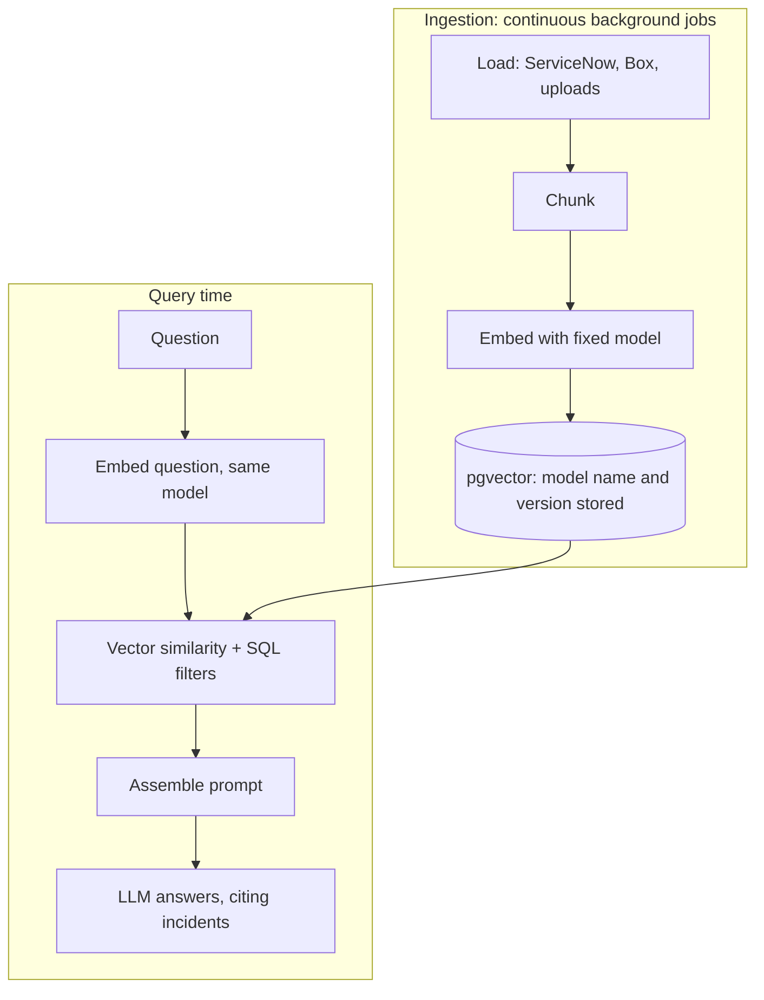

- The **same embedding model** is used for ingestion and queries in every environment. Changing it means re-embedding everything. Candidate: `nomic-embed-text` (TODO after evals).
- Retrieval combines vector similarity with ordinary SQL filters in one query (date, project, source, status, resolver), using an HNSW index.
- Vectors live in PostgreSQL, not Pinecone, because ticket data must not leave the network and the Search page needs relational filters ([ADR 0005](docs/adr/0005-postgres-pgvector.md)).
- Ticket text is untrusted input inside prompts, so prompt injection is checked in review.

RAG supplies the **knowledge** (which incidents happened, who fixed them). The LoRA adapter supplies the **behaviour** (RCA template and tone). They do not replace each other.

## Fine-tuning (LoRA)

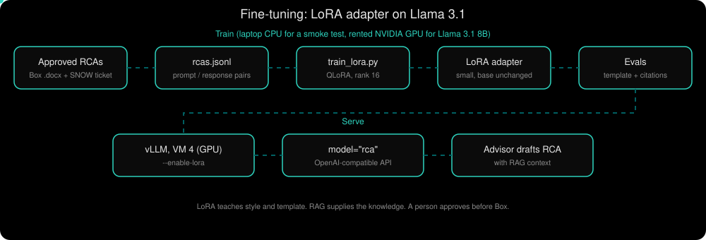

The Advisor runs on Llama 3.1 8B Instruct with a LoRA adapter trained on the team's RCAs. LoRA trains a small set of extra weights and leaves the base model untouched, so the adapter is small and vLLM can load it next to the base model.

| What | Value |
|---|---|
| Script | `backend/scripts/train_lora.py`, one file |
| Base model | `meta-llama/Llama-3.1-8B-Instruct` on a GPU, `Qwen/Qwen2.5-0.5B-Instruct` on a laptop CPU |
| Method | QLoRA (4-bit) on GPU, plain float32 LoRA on CPU, rank 16, alpha 32 |
| Targets | `q_proj k_proj v_proj o_proj gate_proj up_proj down_proj` |
| Data | JSONL of `{"prompt", "response"}` pairs: ticket text in, approved RCA in the exact template out |
| Output | Adapter in `--out`, plus a merged model with `--merge` for Ollama |

```sh
pip install "transformers>=4.44" peft trl datasets accelerate torch   # GPU also: bitsandbytes
python backend/scripts/train_lora.py --data rcas.jsonl --out ./lora-rca --merge
```

**Serve it with vLLM** on the GPU server:

```sh
vllm serve meta-llama/Llama-3.1-8B-Instruct --enable-lora \
  --lora-modules rca=./lora-rca --max-lora-rank 16
```

Call the OpenAI-compatible API with `model="rca"` for the tuned model, or the base model name for the original. Locally, import the merged model into Ollama.

**No GPU?** Run the CPU path on a small model to prove the pipeline, then train Llama 3.1 8B on a free Colab or Kaggle T4, or a rented A100 or L4. A 4-bit 8B model needs roughly 5-6 GB for weights plus KV-cache headroom, and about 16 GB at 16-bit.

### Training data

| Source | Use |
|---|---|
| Existing RCA Word documents in Box (one template) | The `response`: the RCA text per template section |
| The matching ServiceNow incident (description, work notes, resolution comments, root cause code) | The `prompt` |
| Rejected or heavily edited AI drafts, after approval | Later rounds: learn from engineer edits |

Only approved RCAs are used. Ticket data stays on the company network, so training runs on an approved machine. The historical spreadsheet column mapping is still TODO (it needs a copy of the spreadsheet).

### Evaluation plan

About 30 real questions with known answers live in `backend/evals/` and run after any change to the prompt, chunking, embedding model, LLM or adapter. For the adapter, compare base versus base + LoRA on held-out RCAs, and keep the adapter only if it wins.

| Metric | Base Llama 3.1 | + LoRA adapter |
|---|---|---|
| All template sections present, in order | not measured yet | not measured yet |
| Root cause code matches the ticket | not measured yet | not measured yet |
| Every cited incident exists | not measured yet | not measured yet |
| Seconds per draft on the GPU | not measured yet | not measured yet |

> **Caution.** Held-out RCAs from the same authors and template measure format and style, not whether a root cause is correct. A person still reads every draft.

> **Decision.** [ADR 0031](docs/adr/0031-lora-for-rca-style.md) adds LoRA for RCA template and style and supersedes the "Do not fine-tune" part of [ADR 0009](docs/adr/0009-rag-over-fine-tuning.md). The adapter is adopted only if it beats the base model on the evals.

## Data model (draft)

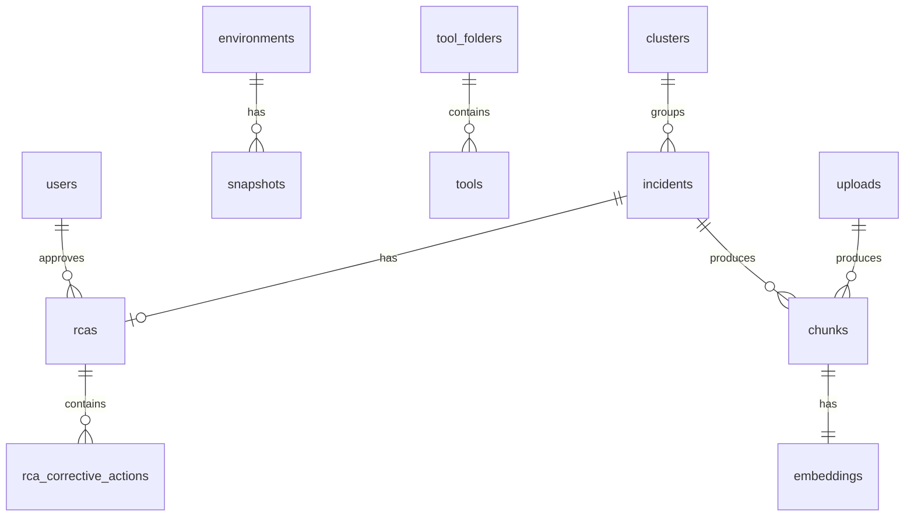

Every schema change goes through Alembic migrations in `backend/alembic/`. Each embedding row stores the model name and version. Alembic is unrelated to LoRA: it versions the SQL schema. The full draft schema is in `docs/architecture/database.md`.

## API routing: from component to database

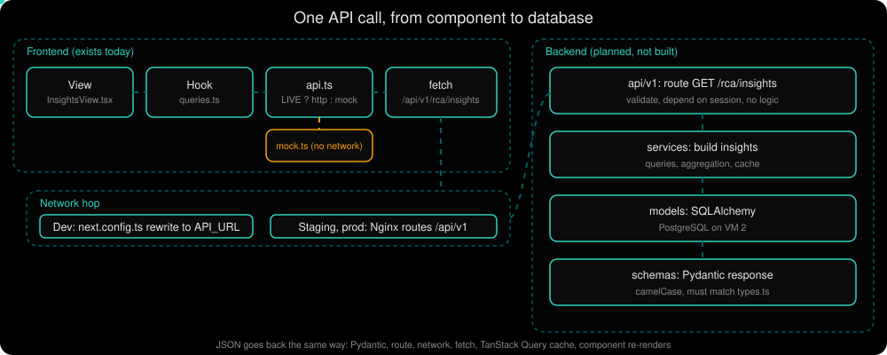

The frontend and the backend share no imports. They connect through a URL path and matching JSON shapes. Everything on the left of the network hop exists today. The backend code below is an example of the planned shape, because `backend/app/` holds only README placeholders.

| Layer | File | Role |
|---|---|---|
| View | `src/components/views/*View.tsx` | Asks for data through a hook. Never calls `fetch` |
| Hook | `src/lib/queries.ts` | TanStack Query: cache, loading and error state |
| Network | `src/lib/api.ts` | The only file that touches the network. Switches mock and live |
| Mock | `src/lib/mock.ts`, `mock-data.ts` | Fake backend, used when the mode is not live |
| Contract | `src/lib/types.ts`, `docs/PRD.md` §7 | Request and response types, route table |
| Hop | `next.config.ts` (dev), Nginx (staging, production) | Sends `/api/v1/*` to FastAPI |
| Route | `backend/app/api/v1/` | Receives and validates. No business logic |
| Service | `backend/app/services/` | The logic: reads Postgres, Redis, vLLM |
| Schema | `backend/app/schemas/` | Pydantic response shape, must match `types.ts` |
| Model | `backend/app/models/` | SQLAlchemy tables |

### Step 1: the view asks for data

`src/components/views/InsightsView.tsx`

```tsx
export function InsightsView() {
  const { data, isLoading, error } = useInsights();
  if (isLoading) return <p className="panel ...">Loading insights…</p>;
  if (error || !data) return /* error state */;
  /* render charts from data.clusters, data.monthly, ... */
}
```

### Step 2: the hook wraps the call

`src/lib/queries.ts`

```ts
export const useInsights = () => useQuery({ queryKey: ["insights"], queryFn: api.insights });
```

The `queryKey` is the cache key. Two components that call `useInsights()` share one request.

### Step 3: `api.ts` picks mock or live

`src/lib/api.ts`

```ts
const LIVE = process.env.NEXT_PUBLIC_API_MODE === "live";
const BASE = "/api/v1";

async function http<T>(path: string, init?: RequestInit): Promise<T> {
  const res = await fetch(`${BASE}${path}`, init);
  if (!res.ok) throw new Error((await res.text()) || `Request failed (${res.status})`);
  return res.json() as Promise<T>;
}

export const api = {
  insights: (): Promise<Insights> => (LIVE ? http("/rca/insights") : mock.mockInsights()),
};
```

- **Mock mode (today):** `mock.mockInsights()` in `src/lib/mock.ts` returns data from `mock-data.ts`. No network call.
- **Live mode:** `fetch("/api/v1/rca/insights")`. `NEXT_PUBLIC_*` values are inlined at build time, so rebuild after changing the mode.
- **Types:** `Insights` in `src/lib/types.ts` is the response contract.

### Step 4: the request reaches the backend

The browser only ever calls its own origin, `/api/v1/...`, so there is no CORS to configure.

**Development.** `next.config.ts` forwards the path when `API_URL` is set:

```ts
const api = process.env.API_URL;
async rewrites() {
  return api ? [{ source: "/api/v1/:path*", destination: `${api}/api/v1/:path*` }] : [];
}
```

```sh
# .env.local
NEXT_PUBLIC_API_MODE=live
API_URL=http://localhost:8000
```

**Staging and production.** Nginx terminates TLS, applies ingress rate limiting and routes. Config lives in `infra/nginx/` (placeholder today).

```nginx
location /api/v1/ {
    proxy_pass http://backend:8000;
    proxy_set_header X-Request-ID $request_id;
}
location / {
    proxy_pass http://frontend:3000;
}
```

### Step 5: the backend (example, not built yet)

**Entry point.** `backend/app/main.py`

```python
from fastapi import FastAPI
from app.api.v1.router import api_router

app = FastAPI(title="GEV System Delivery")
app.include_router(api_router, prefix="/api/v1")

@app.get("/health")
async def health(): ...
```

**Route.** `backend/app/api/v1/rca.py` receives the call and holds no logic ([ADR 0001](docs/adr/0001-modular-monolith.md)).

```python
from fastapi import APIRouter, Depends
from sqlalchemy.ext.asyncio import AsyncSession
from app.core.db import get_session
from app.schemas.insights import Insights
from app.services import insights as insights_service

router = APIRouter(prefix="/rca", tags=["rca"])

@router.get("/insights", response_model=Insights)
async def get_insights(session: AsyncSession = Depends(get_session)) -> Insights:
    return await insights_service.build_insights(session)
```

**Schema.** `backend/app/schemas/insights.py`. Fields are camelCase on the wire, because `types.ts` is camelCase.

```python
from pydantic import BaseModel, ConfigDict
from pydantic.alias_generators import to_camel

class CamelModel(BaseModel):
    model_config = ConfigDict(alias_generator=to_camel, populate_by_name=True)

class Insights(CamelModel):
    clusters: list[Cluster]
    monthly: list[MonthlyPoint]
    root_causes: list[NameValue]
    subsystems: list[SubsystemSeverity]
    heatmap: list[HeatmapRow]
    agents: list[AgentInfo]
```

**Service.** `backend/app/services/insights.py` holds the logic and reads from Postgres, so the page stays fast even when the GPU is down.

```python
async def build_insights(session: AsyncSession) -> Insights:
    clusters = (await session.scalars(select(ClusterRow))).all()
    ...
    return Insights(clusters=[...], monthly=[...], ...)
```

**Model.** `backend/app/models/cluster.py`

```python
class ClusterRow(Base):
    __tablename__ = "clusters"
    id: Mapped[str] = mapped_column(primary_key=True)
    name: Mapped[str]
    severity: Mapped[str]
    hours_spent: Mapped[float]
    hours_savable: Mapped[float]
```

The table is created by an Alembic migration, never by hand ([database](docs/architecture/database.md)).

### Step 6: the response travels back

FastAPI validates the return value against `Insights` and sends camelCase JSON. `http<T>()` parses it, TanStack Query caches it under `["insights"]`, and the component re-renders with `data`.

### Example 2: a button click (POST)

**Notify manager.** `src/lib/api.ts` and `queries.ts`:

```ts
notifyManager: (id: string): Promise<Env[]> =>
  LIVE ? post(`/environments/${id}/notify`) : mock.mockNotify(id),
```

```ts
notify: useMutation({
  mutationFn: (id: string) => api.notifyManager(id),
  onSuccess: (d, id) => onSuccess(`Line manager notified about ${id}`)(d),
}),
```

`onSuccess` writes the returned list straight into the `["envs"]` cache with `qc.setQueryData` and shows a toast. The backend route:

```python
@router.post("/environments/{env_id}/notify", response_model=list[Env])
async def notify(env_id: str, session: AsyncSession = Depends(get_session)) -> list[Env]:
    return await environments_service.notify_manager(session, env_id)
```

### Example 3: files in a request (multipart)

**Search with attachments.** The frontend sends one JSON part and the files:

```ts
const body = new FormData();
body.append("payload", JSON.stringify(req));
files.forEach((f) => body.append("files", f));
return http("/rca/search", { method: "POST", body });
```

The backend reads both parts:

```python
@router.post("/search", response_model=SearchResponse)
async def search(
    payload: str = Form(...),
    files: list[UploadFile] = File(default=[]),
) -> SearchResponse:
    req = SearchRequest.model_validate_json(payload)
    return await search_service.run(req, files)
```

Publishing an RCA works the same way, with a `report` JSON part and the `.docx` as `file`.

### Example 4: streamed agent answer

`POST /agent/chat` returns text as it is generated. `streamChat` in `src/lib/api.ts` reads the body in chunks and the sidebar shows each piece:

```ts
const res = await fetch(`${BASE}/agent/chat`, { method: "POST", body: JSON.stringify({...}), signal });
const reader = res.body.getReader();
for (;;) {
  const { done, value } = await reader.read();
  if (done) return;
  yield dec.decode(value, { stream: true });
}
```

Planned backend side, as Server-Sent Events ([ADR 0004](docs/adr/0004-sse-over-websockets.md)):

```python
from fastapi.responses import StreamingResponse

@router.post("/agent/chat")
async def chat(req: ChatRequest):
    async def events():
        async for token in advisor.stream(req):
            yield f"data: {token}\n\n"
    return StreamingResponse(events(), media_type="text/event-stream")
```

The Stop button aborts the `fetch` with its `AbortSignal`, and the server cancels the run when the client disconnects. The frontend currently reads plain text chunks, so moving to the SSE event format is a change to `streamChat` too ([streaming](docs/architecture/streaming.md)).

### Switching an endpoint from mock to live

1. Add or confirm the type in `src/lib/types.ts` and the row in `docs/PRD.md` §7.
2. Build the route, service, schema and model, with tests and a migration if a table changes.
3. In `api.ts` the live branch already calls the path. Set `NEXT_PUBLIC_API_MODE=live` and `API_URL`, and test that page.
4. Use the `connect-frontend-endpoint` skill. Endpoints go live one at a time.

### Errors

`http()` throws the response text, or `Request failed (status)`. The hook exposes it as `error`, and each view shows its own error state. One consistent error body is still TODO ([api](docs/architecture/api.md)).

### Route table

All routes are under `/api/v1`, JSON in camelCase. The contract is `docs/PRD.md` §7 and `src/lib/types.ts`.

| Method | Path | Purpose |
|---|---|---|
| GET | `/rca/incidents`, `/rca/incidents/{number}` | Incident list and detail |
| GET | `/rca/root-cause-codes`, `/rca/filters` | Dropdown values |
| GET, PUT | `/rca/reports/{number}` | Saved RCA, save draft |
| POST | `/rca/reports/{number}/draft` | AI draft |
| POST | `/rca/reports/{number}/publish` | Upload `.docx` to Box |
| GET | `/rca/reports/{number}/word-url` | Word Online link (not in the PRD table yet) |
| POST | `/rca/search` | Directed search with filters and files |
| GET | `/rca/insights` | Clusters and impact |
| POST | `/agent/chat` | Streamed Advisor answer |
| GET, POST, DELETE | `/rca/connections`, `/rca/connections/{id}/connect`, `/rca/connections/{id}/sync` | ServiceNow and Box |
| GET, POST | `/rca/uploads` | File uploads |
| GET | `/environments` | Environments |
| POST | `/environments/{id}/notify`, `/environments/{id}/snapshots/apply-latest` | Snapshot actions |
| GET | `/tools/folders`, `/release/environments` | Tools, build release |

## Other key flows

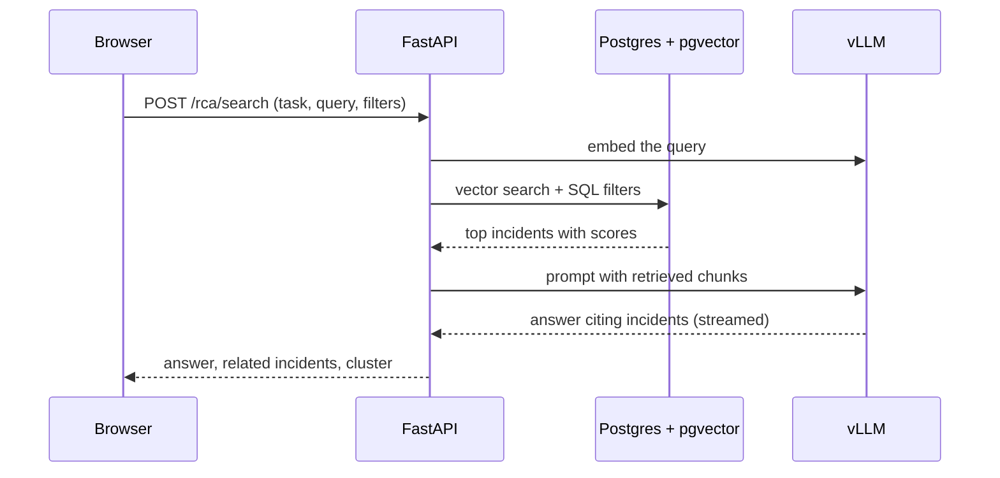

- **ServiceNow sync job.** The worker takes a job, acquires an egress token, fetches incidents since the last sync, upserts idempotently and queues embed jobs. On a 429 it requeues after `Retry-After`. If the circuit breaker is open, the UI shows "last synced X ago".
- **Snapshot logged, manager notified.** `apply-latest` records the snapshot, who and when, then `notify` tells the line manager. The notification method is TODO.
- **Chart click to agent sidebar.** The chart tags the sidebar with its label and numbers, `POST /agent/chat` streams the answer over SSE, and Stop cancels the run.

Full sequence diagrams: `docs/architecture/flows.md`.

## Key decisions

| Decision | ADR |
|---|---|
| Modular monolith, FastAPI with Pydantic | 0001, 0003 |
| On-prem VMs, ticket data stays on the network | 0002 |
| Vectors in Postgres with pgvector | 0005 |
| Redis for queue, cache, agent state | 0006 |
| LangGraph agents with limits and timeouts | 0007 |
| vLLM on the GPU server, Ollama locally | 0008, 0023 |
| RAG for knowledge | 0009 |
| LoRA for RCA template and style, behind an eval gate | 0031 |
| SSE streaming, not WebSockets | 0004 |
| Human approval before Box | 0012 |
| Box is the system of record | 0015 |
| Rate limiting and resilience on every external call | 0019, 0020 |
| Stateless backend instances | 0021 |
| Same embedding model everywhere | 0022 |
| CI on GitHub Actions, same image to production | 0024 |

ADRs live in `docs/adr/`. ADRs record why, architecture docs record how, skills record procedures.

## Safety guardrails

- **Human in the loop.** No RCA reaches Box without explicit approval, and approval records who and when.
- **Fixed template.** Pydantic structured output returns every section in order.
- **Citations.** Advisor answers cite real incidents, and evals check that they exist.
- **Idempotent upload.** A retry never creates a duplicate Box file.
- **Resilience.** Every external call has a timeout, an egress rate limit and a circuit breaker.
- **No secrets in the browser.** Credentials live on the backend and in environment variables.
- **Stateless backend.** No files or sessions on the app VM.
- **Honest unavailability.** The UI shows "AI unavailable" when the model server is down. Other pages are unaffected.
- **Observability.** Structured logs with request IDs, OpenTelemetry and self-hosted agent tracing.

## Repository layout

```
.
├── src/
│   ├── app/(app)/             # pages: admin, build-release, environments, rca, tools
│   ├── components/
│   │   ├── views/             # one client view per page
│   │   ├── rca/               # side panel, row actions, chart pin, follow-up
│   │   └── ui/                # shadcn only
│   └── lib/
│       ├── api.ts             # the only network layer, mock/live switch
│       ├── types.ts           # the API contract types
│       ├── mock.ts, mock-data.ts
│       ├── queries.ts         # TanStack Query hooks
│       └── rca-docx.ts, rca-html.ts, use-rca-doc.ts
├── backend/                   # FastAPI modular monolith (planned)
│   ├── app/{api/v1,services,agents,integrations,workers,models,schemas,core}
│   ├── alembic/               # migrations
│   ├── evals/                 # about 30 AI evaluation questions
│   ├── scripts/train_lora.py  # LoRA fine-tuning, CPU or GPU
│   └── tests/{unit,integration}
├── infra/                     # Docker Compose and Nginx
├── docs/
│   ├── PRD.md                 # spec and API contract
│   ├── architecture/          # how it works, per area and per agent
│   ├── adr/                   # why decisions were made
│   ├── assets/                # animated SVGs used in this README
│   ├── checklists/            # per-feature checklists
│   └── README-original.md     # the previous README
├── CLAUDE.md, AGENTS.md       # rules for people and AI assistants
└── .claude/skills, .devin/    # recipes, reviewers, testers
```

## Quick start

Prerequisites: Node 20+ and npm. Docker for the later backend.

```sh
npm i
cp .env.example .env.local   # NEXT_PUBLIC_API_MODE=mock | live
npm run dev                  # http://localhost:3000
```

| Command | Purpose |
|---|---|
| `npm run dev` | Start the app |
| `npm run lint` | Lint |
| `npm run typecheck` | Type-check |
| `npm run build` | Production build |
| `npm run format` | Format |

Run lint, typecheck and build before opening a pull request.

**Backend, once it exists** (commands from `docs/commands.md`):

```sh
docker compose -f infra/docker-compose.yml up -d     # Postgres and Redis
cd backend && uv sync
uv run alembic upgrade head
uv run fastapi dev app/main.py                       # http://localhost:8000/docs
```

## Configuration

| Variable | Purpose | Where |
|---|---|---|
| `NEXT_PUBLIC_API_MODE` | `mock` (default) or `live` | Frontend `.env.local` |
| `API_URL` | FastAPI address that `/api/v1` is rewritten to | Frontend |
| Database connection string | Postgres on VM 2 | Backend `.env`, never in Git |
| LLM `base_url` and model name | Ollama locally, vLLM on staging and production (`rca` for the tuned model) | Backend settings |
| ServiceNow and Box credentials | Integration clients | Backend `.env`, never in the browser |

Exact backend setting names are not decided yet.

## What is real and what is not yet

| Works now (UI on mock data) | Needs the backend |
|---|---|
| All pages, filters, charts, chart-to-agent flow | Real ServiceNow and Box connections |
| Create RCA list, form side panel, image upload | Real AI drafts (currently rule-based from ticket text) |
| Word view and editor, `.docx` download | Real agent answers (currently scripted) |
| Environment actions, tools export | Database, real Box upload, Word Online, authentication |

Mock data is four environments (PD1, PD2, MPR1, MPR2), about 20 incidents and three clusters. Reports, uploads and connections are stored in the browser so the Word tab sees the same data.

## Testing and evaluation

| Layer | What |
|---|---|
| Unit | Per node with fake model clients, per service, per route |
| Integration | Upserts and migrations against real Postgres |
| Evals | About 30 questions in `backend/evals/` for retrieval, the Advisor and the adapter. Must pass on staging (vLLM), not only the laptop |
| CI | GitHub Actions: lint, typecheck, build, tests, `alembic upgrade head` on an empty DB, `alembic check` |

Tests never call a real LLM except the evals. The staging image that passes is the one promoted to production.

## Limitations

- **Nothing AI is built yet.** Drafts and agent answers in the UI are rule-based or scripted.
- **No model results.** Accuracy of the base model, the adapter and retrieval is unmeasured.
- **Training needs approved data.** Enough approved RCAs in the exact template must be exported from Box, and the historical spreadsheet mapping is unknown.
- **GPU unconfirmed.** The GPU model, Hugging Face access from the GPU server, and the LLM size are TODO with IT.
- **Authentication is undecided.** The method is proposed and needs IT.
- **Backups.** Self-hosted Postgres means backups are no longer automatic. Owner and schedule are TODO.
- **Open formulas.** The clustering algorithm, the definition of hours savable and the notification method are undecided.
- **Desktop-first.** Homepage widgets and bookmarks are stored per browser until sign-in exists.

## Roadmap

- [x] Next.js UI on mock data with the mock/live switch
- [x] Architecture docs, 26+ ADRs, skills and review agents
- [x] ADR 0031 records LoRA as part of the plan
- [ ] FastAPI skeleton, `/health`, Alembic migrations and the pgvector tables
- [ ] ServiceNow and Box integrations with limiters and circuit breakers
- [ ] RAG ingestion and retrieval, with about 30 evals
- [ ] vLLM on the GPU server and the five LangGraph agents
- [ ] Export approved RCAs to `rcas.jsonl`, train the LoRA adapter, compare against base, serve with `--enable-lora`
- [ ] Switch `src/lib/api.ts` from mock to live, one endpoint at a time
- [ ] Authentication, once IT confirms the method
- [ ] Staging, then production, with the same Docker image

## Questions you may be asked

**Why not just use ServiceNow?** It has the tickets, but no pattern detection, no RCA drafting, and nothing for tools, onboarding or environment tracking.

**Does it replace Box?** No. Box stays the system of record. The app writes to it after approval and reads from it.

**Who writes the RCA?** The agent drafts what ServiceNow can answer. The engineer completes what only they know and approves.

**How are patterns found?** Incidents are embedded and clustered by root cause. The Impact agent adds up hours spent and hours a permanent fix would save.

**Why LoRA and RAG?** RAG gives the model the team's incidents at question time and stays current. LoRA teaches it the RCA template and tone. One does not replace the other.

**Why pgvector and not Pinecone?** Ticket data must stay on the network, and Search filters vectors by SQL fields in one query.

**What if the GPU server is down?** AI features show "AI unavailable". Every other page keeps working.

**Where does ticket data go?** Nowhere outside the company network.

## Docs

`docs/PRD.md` (spec) · `docs/architecture/` (how) · `docs/adr/` (why) · `docs/commands.md` · `docs/runbook.md` · `docs/security.md` · `docs/testing.md` · [previous README](docs/README-original.md)

## Requirements request: software, VMs, hardware and tools (added 2026-10-15)

Request list for IT, the manager and security. Sources are in the last column. Sizes marked "proposed" are starting estimates, not decisions: no document sets them, so IT must confirm. Everything runs on the company network ([ADR 0002](docs/adr/0002-on-premises-vms.md)).

### Virtual machines and hardware

| # | Item | What it is | Why we need it | Proposed size | Source |
|---|---|---|---|---|---|
| 1 | VM 1: Application server | Runs Nginx, the Next.js frontend, the FastAPI backend and the background worker as Docker containers | Serves the web app and runs the API and the four background jobs | 4 vCPU, 16 GB RAM, 100 GB disk (proposed) | ADR 0002, deployment.md |
| 2 | VM 2: Database server | PostgreSQL 16 with the pgvector extension | Stores all durable data and the search vectors; ticket data must not leave the network | 4 vCPU, 16 GB RAM, 200 GB disk, with backups (proposed) | ADR 0002, ADR 0005 |
| 3 | VM 3: Redis server | Redis 7 | Job queue, cache and agent state | 2 vCPU, 8 GB RAM, 20 GB disk (proposed) | ADR 0002, ADR 0006 |
| 4 | VM 4: AI model server (GPU) | A GPU machine running vLLM for the private LLM, and probably the embedding model | Private AI drafting, search and chat without sending data outside | GPU with 24 GB or more memory (for example NVIDIA L4 24 GB or A100 40/80 GB); an 8B model needs about 16 GB at full precision or 5-6 GB 4-bit, plus room for the KV cache | llm-serving.md |
| 5 | Staging environment | A second set of the above, or a smaller test VM | Test changes and run the AI evals before production | Smaller than production (proposed) | deployment.md, ADR 0016, ADR 0023 |
| 6 | Production environment | The four VMs above | Real use by 200-1,000 internal users | See rows 1-4 | requirements.md |
| 7 | Backup storage | Storage and a schedule for Postgres backups | Supabase backups were automatic; on-prem we must arrange them. Owner is TODO | Size depends on database growth | ADR 0002 |
| 8 | File storage for uploads | Storage that is not the app VM's disk | The backend must stay stateless | TODO | scaling.md |

### Network and access

| Item | What it is | Why we need it | Source |
|---|---|---|---|
| Static internal IPs or DNS names | Fixed addresses for all VMs | Services find each other reliably | ADR 0002 |
| Firewall rules | App VM to the database, Redis, GPU server, ServiceNow and Box | The app cannot work without these connections | deployment.md |
| HTTPS certificate | A certificate for the app's internal name | Nginx terminates HTTPS | ADR 0011 |
| ServiceNow API access | Credentials, scope and rate limits from the ServiceNow admins | Read incident data | open-questions.md |
| Box API access | Credentials and rate limits from the Box admins | Upload approved RCAs; Box is the system of record | ADR 0015 |
| Sign-in method | Probably Microsoft Entra ID (SSO) and an app registration | Per-user access; still proposed | ADR 0013 |
| Hugging Face access, or a way to transfer files | The GPU server must download model weights, or we copy them in | Get the LLM and embedding model | llm-serving.md |
| Secrets storage | A place for production secrets | Credentials stay out of Git and the browser | open-questions.md |
| Notification channel | Email, Teams or in-app (undecided) | Tell the line manager when a snapshot is applied | open-questions.md |

### Software and services

| Item | What it is | Why we need it | Source |
|---|---|---|---|
| Docker and Docker Compose | Container packaging | The same image runs on a laptop, staging and production | ADR 0016 |
| Container registry | GitHub Container Registry or an internal one | Store the images CI builds; production promotes the staging image | ci-cd.md, ADR 0024 |
| GitHub and GitHub Actions | Code hosting and CI | Lint, tests and builds on every pull request | ADR 0024 |
| Self-hosted runner, or IT's deploy tool | A CI runner inside the network | CI cannot reach internal VMs otherwise | ADR 0024 |
| Nginx | Web server and reverse proxy | HTTPS, routing, ingress rate limiting, SSE settings | ADR 0011 |
| Node.js and the Next.js app | Frontend runtime | Serves the UI | CLAUDE.md |
| Python and FastAPI, SQLAlchemy, Alembic | Backend and database migrations | API, logic, schema changes | ADR 0003, AGENTS.md |
| PostgreSQL 16 with pgvector | Database and vector search | Durable data and RAG search | ADR 0005 |
| Redis 7 | Queue, cache, agent state | Background jobs and agents | ADR 0006 |
| LangGraph | Agent framework | The agent steps with limits and timeouts | ADR 0007 |
| vLLM | Model server on the GPU | Handles many requests at once | ADR 0008 |
| Ollama | Local model server | Laptop development only | ADR 0023 |
| LLM and embedding models | Open models served by us; choice is TODO after evals | The AI itself | models.md |
| Observability stack | JSON logs, OpenTelemetry, and self-hosted tracing (Langfuse candidate) | See errors, latency and agent steps without data leaving the network | observability.md, ADR 0025 |
| Alerting tool | Alert channel is TODO | An error alert must fire before launch | observability.md |

### AI development tools

| Item | What it is | Why we need it | Notes |
|---|---|---|---|
| Devin Enterprise | The Devin coding agent (CLI and desktop app) with enterprise terms | Builds and reviews the code in this repo, using `AGENTS.md` and `.devin/` | Enterprise is the tier with admin and data controls; confirm the exact plan with the vendor |
| Claude Pro | A Claude subscription for Claude Code | Alternative coding agent, using `CLAUDE.md` and `.claude/` | Pro is an individual plan; confirm it is allowed for company code |

Both tools send code to an outside AI service. Security must approve this before they touch the repo. Real ServiceNow or Box data must never go into them, only mock data. This matches the open question "Is any external AI API allowed during development?" in `docs/context/open-questions.md`.

### Still unconfirmed

Number of VMs ("sparse server" is undefined), exact sizes, GPU model, backup owner, auth method, CI platform. All are tracked in `docs/context/open-questions.md`.
