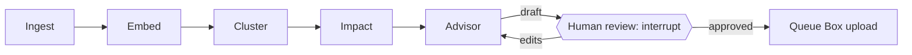

# Agents

**Purpose:** what an agent is in this system, how the Advisor agent and the four background jobs fit together, and where each runs.

**Related ADRs:** [0007 LangGraph](../../adr/0007-langgraph.md), [0012 human review](../../adr/0012-human-review.md), [0022 model routing](../../adr/0022-model-routing.md), [0026 interactive vs batch](../../adr/0026-interactive-vs-batch-agents.md), [0009 RAG](../../adr/0009-rag-over-fine-tuning.md)

Last updated: 2026-10-08

Job and agent docs: [ingest](ingest.md), [embed](embed.md), [cluster](cluster.md), [impact](impact.md), [advisor](advisor.md). None of the agent code exists yet.

## What an agent is in this system

An agent does not just answer once; it loops until a task is complete. LangGraph models this as a directed graph:

- **Nodes:** functions (the agents or steps).
- **Edges:** paths between nodes, including conditional paths.
- **State:** shared memory, like a whiteboard, that moves with the work from node to node. One agent writes to it; the next reads from it.

Real work is not linear, and the graph allows three things a simple input, AI, output chain cannot:

- **Loop back:** "the data looks wrong, research again."
- **Branch:** "if urgent, route one way; if routine, another."
- **Wait:** "pause until the user clicks Approve" (LangGraph interrupts). This is how mandatory human review of RCAs ([ADR 0012](../../adr/0012-human-review.md)) is implemented.

Writing this as plain if/else code becomes unmanageable quickly. LangGraph tracks where the work is, what has already been done and what comes next, and with a checkpointer it can resume after a failure rather than start again. The handoff pattern Research, Approval, Execution maps directly onto the RCA flow: Draft, Human review, Upload to Box.

## Only the Advisor is an agent

Ingest, Embed, Cluster and Impact are background jobs in the worker. They are described in this folder in the same format for convenience, but they are plain Python steps, not LLM agents. Only the Advisor reasons with the LLM. See [ADR 0032](../../adr/0032-one-agent-and-background-jobs.md).

## Not every step needs an LLM

Using the LLM only where reasoning is needed improves accuracy, speed and GPU load.

| Job or agent | LLM? | What it really is |
|---|---|---|
| Ingest | No | Fetch and normalise data from ServiceNow, Box and uploads. |
| Embed | No (embedding model call) | Chunk text, call an embedding model, store vectors. |
| Cluster | Only to name clusters | A clustering algorithm over vectors (algorithm TODO); the LLM names the groups. |
| Impact | No | Mainly arithmetic over recorded hours. |
| Advisor | Yes | Answers questions, powers Search, drafts RCAs. |

## Where the Advisor and the jobs run

- **Interactive work runs in the API process and streams over SSE:** Advisor answers in the sidebar and Search, and a single RCA draft when the user clicks.
- **Long or batch work runs in the background worker from the queue:** Ingest, Embed, Cluster, Impact, and bulk drafting for historical incidents.
- The strategy notes proposed sending every RCA flow to a queue. Interactive flows stay in the API so the user sees streaming. If drafting proves too slow, it moves to the worker with progress streamed. TODO: decide after measuring. See [ADR 0026](../../adr/0026-interactive-vs-batch-agents.md).

## Safeguards (apply to every graph)

Maximum iterations (LangGraph recursion limit), a timeout per node, bounded retries, checkpointing so a failed run resumes, and de-duplication so the same RCA task is never processed twice at once. Details in [resilience.md](../resilience.md).

## State

State may be kept in Redis or a Postgres checkpointer. TODO: decide ([ADR 0006](../../adr/0006-redis.md)). Durable data (RCAs, incidents) always lives in Postgres.

## Testing

Unit tests per node with fake model clients; eval questions in `backend/evals/` for the Advisor and retrieval ([testing.md](../../testing.md)). Tests never call a real LLM except evals.
