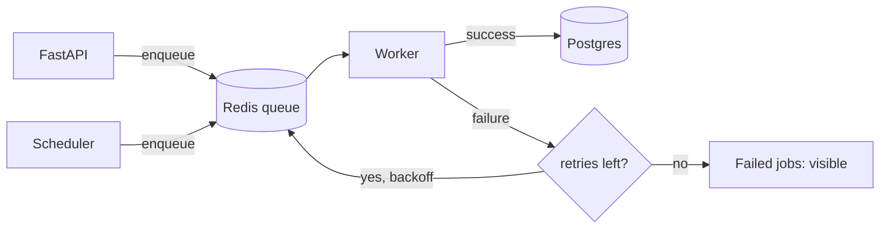

# Background jobs

**Purpose:** how slow or retry-able work is done outside the request path.

**Related ADRs:** [0006 Redis](../adr/0006-redis.md), [0010 background worker](../adr/0010-background-worker.md), [0019 rate limiting](../adr/0019-rate-limiting.md), [0020 resilience](../adr/0020-resilience.md), [0026 interactive vs batch agents](../adr/0026-interactive-vs-batch-agents.md)

Last updated: 2026-10-08. Not built yet (build plan 5.7).

## Job queue

A **worker** is a separate process from the same codebase. It takes jobs from a queue in Redis. Jobs: ServiceNow sync, Box sync, Box uploads, embedding, and batch agent runs (Ingest, Embed, Cluster, Impact, bulk drafting for historical incidents). Sync jobs run on a schedule; interval is TODO inside the 30-60 s consistency target.

Library: arq vs Celery. TODO: choose in step 5.7 and record with the `write-adr` skill.

## Retries with backoff

A failed job is retried after a delay that grows each time (exponential backoff) up to a limit. Calls that get HTTP 429 honour `Retry-After` ([rate-limiting.md](rate-limiting.md)).

## Idempotency

Every job and every write has an **idempotency key**, so running it twice has the same effect as running it once. Syncs use upserts; Box uploads use a key such as the problem number plus version so a retried upload does not create a duplicate. The same job queued twice does the work once (build plan 5.7 test).

## Failed jobs

A job that exhausts its retries is kept and visible (not silently dropped). For uploads the RCA status becomes **Upload failed** and the UI shows it. Where operators see failed jobs (admin page, logs or a dashboard) is TODO.

## At-least-once delivery to Box

1. The approved RCA is saved in Postgres first.
2. The upload job is queued.
3. The worker retries until Box confirms.
4. Only then does the status become In Box.

Because delivery is at-least-once, idempotency is what prevents duplicates. If Redis loses the queue, the database status ("Approved/Uploading") lets the job be re-queued. See [redis.md](redis.md).

## Writing a job

Use the skill `new-background-job`: function in `backend/app/workers/`, idempotency key, retries with backoff, final-failure behaviour, unit test, and an entry here.
