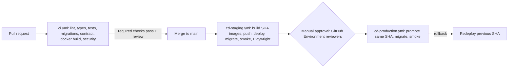

# CI/CD

**Purpose:** how every change is checked and how it reaches staging and production.

**Related ADRs:** [0024 CI/CD with GitHub Actions](../adr/0024-cicd-github-actions.md), [0016 environments and Docker](../adr/0016-environments-docker.md), [0017 testing and CI](../adr/0017-testing-ci.md)

Last updated: 2026-10-08. No workflow files exist yet (no `.github/`). TODO: confirm the repo is on GitHub (or GitHub Enterprise) and that Actions and self-hosted runners are allowed.

## Pipeline

## CI: runs on every pull request and every push

- Frontend: `npm ci`, lint, type-check, build, unit tests.
- Backend: Ruff lint, Ruff format check, mypy, pytest unit tests; integration tests with Postgres (pgvector image) and Redis as **service containers**; `alembic upgrade head` on an empty database; `alembic check` to catch model changes without a migration.
- Contract: regenerate the TypeScript types from OpenAPI and fail if they differ from the committed ones.
- Docker: build all images (not pushed on pull requests).
- Security: dependency audit (`pip-audit`, `npm audit`), secret scanning (gitleaks), optionally CodeQL.
- These jobs are **required status checks**; `main` is protected and needs a reviewed pull request.
- Dependabot keeps dependencies updated.

The pipeline grows with the app; the table "When each check joins the pipeline" at the end of `docs/build-plan.md` says when each check is added.

## CD: runs after merge

- On merge to `main`: build images tagged with the git commit SHA, push to the container registry (TODO: GitHub Container Registry or an internal registry), deploy to staging, run migrations, smoke tests, then Playwright end-to-end tests against staging.
- Production: a separate workflow using a GitHub **Environment with required reviewers** (manual approval). It promotes **the same image SHA** that passed staging; images are never rebuilt for production. Then migrations and smoke tests.
- Rollback: redeploy the previous SHA.
- **On-prem constraint:** GitHub's hosted runners cannot reach internal VMs. Deployment needs either a **self-hosted runner inside the company network** or an IT-managed tool that pulls the images. TODO with IT.

## Workflow files

| File | Trigger | Jobs |
|---|---|---|
| `ci.yml` | pull request, push | frontend (install, lint, type-check, build, unit tests); backend (Ruff, format, mypy, pytest with service containers, alembic upgrade and check); contract (type drift); docker build; security |
| `cd-staging.yml` | merge to `main` | build and tag images with SHA, push, deploy to staging, migrate, smoke tests, Playwright |
| `cd-production.yml` | manual, after staging, environment approval | promote same SHA, migrate, smoke tests |
| `evals.yml` | manual; pull requests labelled `ai` | run `backend/evals/`, store results, compare with previous run; likely a self-hosted runner because it needs model access |

## Required status checks and approvals

Required: the CI jobs above. Production environment requires reviewers. Keep required checks in sync with branch protection (skill `ci-cd-change`).

## Image tagging

`<registry>/gev-backend:<git-sha>` and `gev-frontend:<git-sha>` (names follow `docs/commands.md`: `gev-backend`, `gev-frontend`). Registry is TODO.

## Secrets

Never in workflow files. GitHub Environment secrets or the company vault. Workflow permissions are minimal and action versions are pinned.
