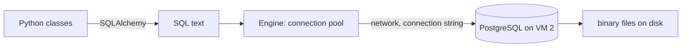
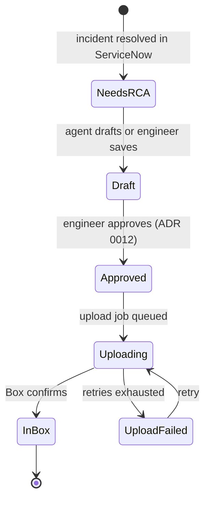
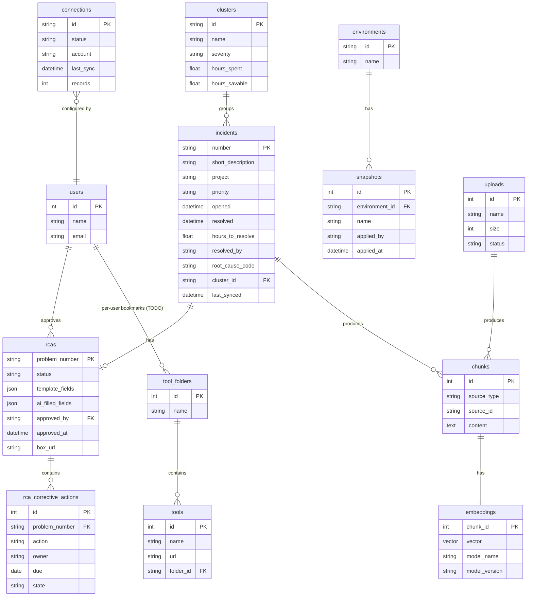

# Database

**Purpose:** how the backend talks to PostgreSQL, how schema changes are managed, and the draft schema.

**Related ADRs:** [0002](../adr/0002-on-premises-vms.md) on-premises VMs, [0005](../adr/0005-postgres-pgvector.md) Postgres + pgvector, [0015](../adr/0015-box-system-of-record.md) Box as system of record, [0022](../adr/0022-model-routing.md) fixed embedding model

Last updated: 2026-10-08

## Mental model

- The database runs on its own server (VM 2). PostgreSQL stores tables as binary files on that server's disk; only PostgreSQL can read them. FastAPI runs on a different server and knows only the database's network address.
- **Connection string** (in `.env`, never in Git): address, port, database name, username, password.
- **SQLAlchemy** translates Python classes and objects into SQL.
- **Engine:** a connection pool, a set of open "phone lines" to the database, reused for speed.
- **Session:** one unit of work. Open, do the work (for example save an RCA), `commit()`, close.
- **Alembic migrations** live in Git and define every table change. A new engineer runs `alembic upgrade head` and gets the full schema. Every schema change goes through a migration; nobody edits tables by hand.

## Comparison with the previous stack (Supabase)

Supabase was also Postgres on a remote server reached by a URL in `.env`. The differences now: the server is internal, Python uses SQLAlchemy instead of the Supabase JS client, Supabase migrations become Alembic migrations, and **backups are no longer automatic**. TODO: confirm backup owner and schedule with IT.

## Migrations

Local commands are in `docs/commands.md`. In short: change the model, run `uv run alembic revision --autogenerate -m "<what changed>"`, read and correct the generated file by hand (autogenerate misses things), then `upgrade head`, `downgrade -1`, `upgrade head`. CI runs `alembic upgrade head` on an empty database and `alembic check`. See the `db-migration` skill.

## RCA status lifecycle

The RCA is saved in Postgres **before** the upload is queued. The frontend currently only knows `none | draft | published` (`src/lib/types.ts`); mapping is an open question ([corrections](../context/corrections.md) item 24).

## Draft schema (DRAFT: derived from `docs/PRD.md` and `src/lib/types.ts`, not final)

Notes:
- Table and column names are proposals. Field names for incidents and reports follow `src/lib/types.ts` (`SnowIncident`, `RcaReport`, `Env`, `Folder`, `Cluster`, `UploadItem`, `Connection`).
- Every embedding row stores the **model name and version** that produced it ([ADR 0022](../adr/0022-model-routing.md)).
- Vector search uses an HNSW index in pgvector, combined with ordinary SQL filters (date, project, status, resolver) ([ADR 0005](../adr/0005-postgres-pgvector.md)).
- Homepage widgets and bookmarks are stored per browser today; they need a per-user table once sign-in exists ([auth](auth.md)). TODO.
- Where uploaded files are stored (not the app VM's disk) is TODO ([scaling](scaling.md)).
