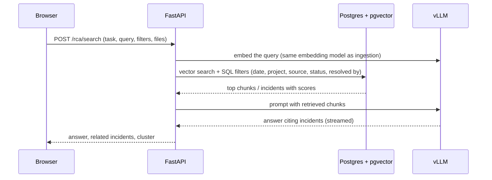
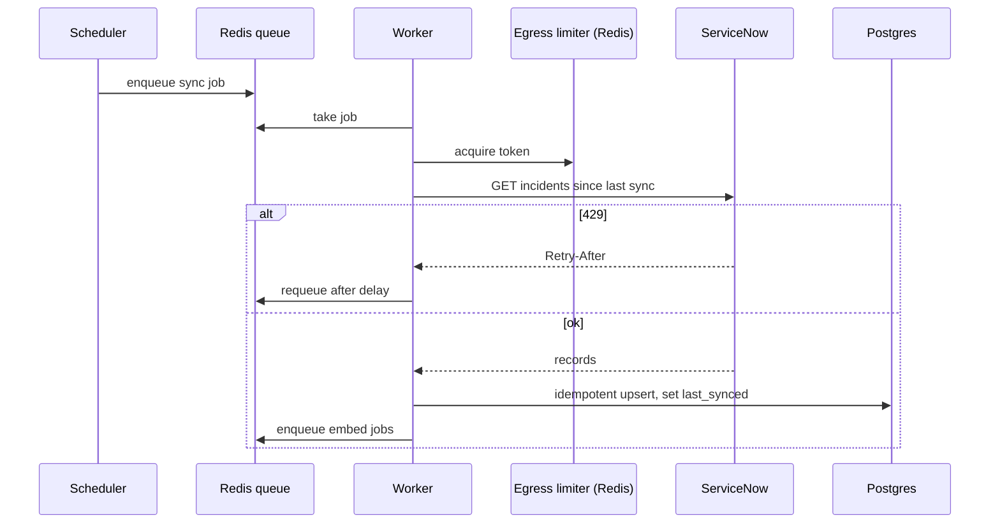
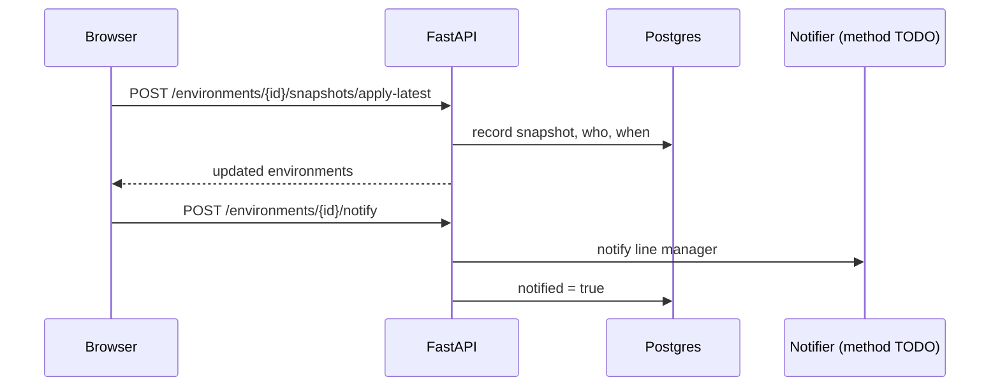
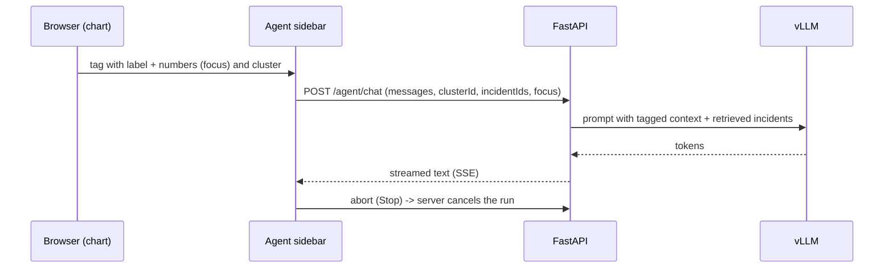

# Key flows

**Purpose:** step-by-step sequence diagrams for the five main flows, each with an explanation.

**Related ADRs:** [0004](../adr/0004-sse-over-websockets.md) SSE, [0010](../adr/0010-background-worker.md) background worker, [0012](../adr/0012-human-review.md) human review, [0015](../adr/0015-box-system-of-record.md) Box, [0019](../adr/0019-rate-limiting.md) rate limiting, [0026](../adr/0026-interactive-vs-batch-agents.md) interactive vs batch agents

Last updated: 2026-10-08

Everything here is the **target** design. Today the frontend runs these flows on mock data (`src/lib/mock.ts`).

## (a) Resolved incident to RCA in Box

```mermaid
sequenceDiagram
  participant SNOW as ServiceNow
  participant W as Worker
  participant DB as Postgres
  participant UI as Browser
  participant API as FastAPI
  participant LLM as vLLM
  participant Box
  W->>SNOW: scheduled sync (rate limited, timeout, circuit breaker)
  SNOW-->>W: resolved incidents, comments, time taken
  W->>DB: upsert incidents (RCA status: Needs RCA)
  UI->>API: GET /rca/incidents
  API->>DB: read
  UI->>API: POST /rca/reports/{n}/draft
  API->>LLM: structured-output draft (Pydantic RCA model)
  LLM-->>API: template sections
  API->>DB: save Draft (ai_filled fields marked)
  UI->>API: PUT /rca/reports/{n} (engineer edits)
  UI->>API: approve (who and when saved)
  API->>DB: save Approved, queue upload job
  W->>DB: load RCA, build or receive .docx
  W->>Box: upload (retries with backoff, idempotent)
  Box-->>W: file id and URL
  W->>DB: status In Box, box_url
```

Steps: (1) the worker syncs incidents on a schedule, so the page never calls ServiceNow live. (2) An incident with no RCA shows **Needs RCA**. (3) The agent drafts only what ServiceNow can answer and the draft marks which fields the AI filled. (4) The engineer edits and **must approve**; nothing reaches Box without approval ([ADR 0012](../adr/0012-human-review.md)). (5) The RCA is saved in Postgres first, then the upload is queued. (6) The worker retries until Box accepts, using an idempotency key so a retry never creates a duplicate. (7) Status becomes **In Box**. TODO: whether the `.docx` is produced in the browser (as today, `src/lib/rca-docx.ts`) or on the server is not decided; the PRD `publish` endpoint accepts the `.docx` from the browser.

## (b) RCA Search with filters



Only the question is embedded at query time. Filters are normal SQL, applied together with vector similarity ([rag.md](rag.md)).

## (c) ServiceNow sync job



Sync interval is TODO (inside the 30-60 s consistency target). If the circuit breaker is open, the job is skipped and the UI shows "last synced X ago" ([resilience.md](resilience.md)).

## (d) Snapshot logged, manager notified



How the manager is notified (email, Teams or in-app) is TODO: confirm with manager. The endpoints are in `docs/PRD.md` section 7. The "auto-notify on snapshot" toggle is on the Settings page.

## (e) Chart click to agent sidebar



The request body matches `streamChat` in `src/lib/api.ts`. The stream is currently read as plain text chunks; moving to the SSE event format is part of [streaming.md](streaming.md).
