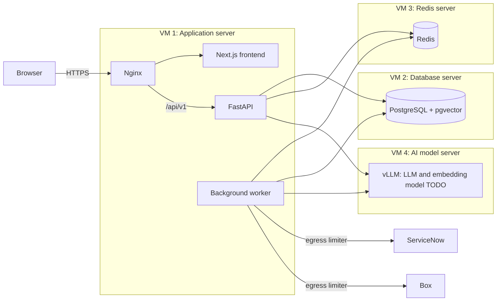
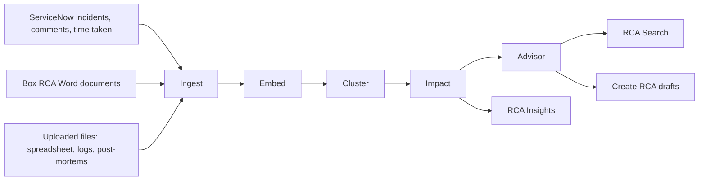

# High-level architecture

**Purpose:** the big picture. What the parts are, which VM runs what, how a request travels, and how data flows from sources to the pages.

**Related ADRs:** [0001](../adr/0001-modular-monolith.md) modular monolith, [0002](../adr/0002-on-premises-vms.md) on-premises VMs, [0003](../adr/0003-fastapi.md) FastAPI, [0005](../adr/0005-postgres-pgvector.md) Postgres + pgvector, [0006](../adr/0006-redis.md) Redis, [0007](../adr/0007-langgraph.md) LangGraph, [0008](../adr/0008-vllm.md) vLLM, [0011](../adr/0011-nginx.md) Nginx, [0021](../adr/0021-stateless-backend.md) stateless backend

Last updated: 2026-10-08

Status: this is the **target** design. Today only the Next.js frontend exists, running on mock data (`src/lib/api.ts`, `NEXT_PUBLIC_API_MODE=mock`).

## Component diagram

## Which VM runs what

| Resource | Purpose |
|---|---|
| VM 1: Application server | Nginx, the Next.js frontend, the FastAPI backend and the background worker, all as Docker containers. |
| VM 2: Database server | PostgreSQL with the pgvector extension. |
| VM 3: Redis server | Job queue, cache and LangGraph agent state. |
| VM 4: AI model server | GPU machine running vLLM for the private LLM (and the embedding model, TODO confirm). |
| Internal IP/DNS | Static internal addresses so the app can always find the other servers. |
| Firewall rules | App server may talk to DB, Redis, GPU server and external tools (ServiceNow, Box). |

TODO: confirm with manager what "sparse server" means (one dedicated VM, or the four above). See [ADR 0002](../adr/0002-on-premises-vms.md).

## Request flow

1. The browser sends an HTTPS request to Nginx.
2. Nginx terminates TLS, applies rate limiting, and routes: `/` to Next.js (pages) and `/api/v1` to FastAPI (data).
3. FastAPI authenticates the caller (method TODO, see [auth](auth.md)), validates input with Pydantic and calls a **service**.
4. The service reads or writes PostgreSQL, uses Redis for cache or queues, or calls vLLM for AI work.
5. External systems (ServiceNow, Box) are **not** called on page load. The background worker syncs them into Postgres, so pages read from the database ([ADR 0010](../adr/0010-background-worker.md)).
6. The response goes back through Nginx to the browser. For AI answers the response is streamed over SSE ([streaming](streaming.md)).

The background worker is a separate process from the same codebase. It takes jobs from Redis: ServiceNow sync, Box sync, Box uploads and embedding.

## The three planes

| Plane | What lives there | Why separate |
|---|---|---|
| Presentation | Browser, Nginx, Next.js | Changes with design. Never holds credentials. |
| Reasoning | FastAPI services, LangGraph agents, worker, vLLM | The slow, variable-latency, failure-prone part (LLM calls, external APIs). |
| Data | PostgreSQL + pgvector, Redis | Durable and fast. Dashboards read only from here, so they stay under 500 ms even when the reasoning plane is slow or down. |

The separation is what lets the dashboard keep working when ServiceNow, Box or the GPU server is down ([resilience](resilience.md)).

## Data flow from sources to pages

The five agents are described in [agents/README.md](agents/README.md). Not every agent uses an LLM.

## Where each page reads from

| Page | Source |
|---|---|
| Environments, Tools, Settings | Postgres (non-AI, fast) |
| Create RCA list | Postgres (synced from ServiceNow) |
| Insights | Postgres (clusters and impact produced by agents) |
| Search, Agent sidebar, RCA draft | pgvector retrieval plus vLLM |

See [frontend.md](frontend.md) for the endpoint mapping.
