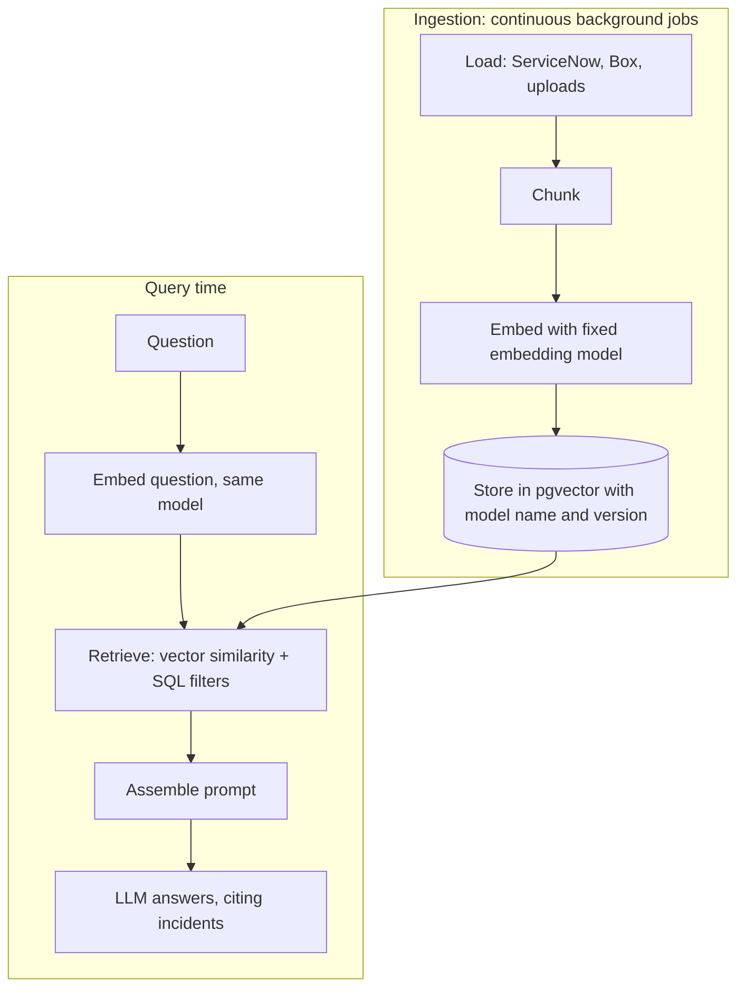

# RAG (retrieval-augmented generation)

**Purpose:** the full pipeline that gives the model the team's knowledge at question time.

**Related ADRs:** [0005 Postgres + pgvector](../adr/0005-postgres-pgvector.md), [0009 RAG over fine-tuning](../adr/0009-rag-over-fine-tuning.md), [0022 model routing](../adr/0022-model-routing.md), [0010 background worker](../adr/0010-background-worker.md)

Last updated: 2026-10-08. Nothing here is built yet. Experiment 4.3 in `docs/build-plan.md` tests a tiny version with Ollama.

## RAG is built before the Advisor

The Advisor and the embedding job depend on retrieval, so the RAG layer (load, chunk, embed, store, search) is built and tested on its own first, with eval questions measuring whether the right incidents come back. Only then are agents built on top.

## Ingestion and querying are separate

Ingestion is a **background job that runs continuously**, because ServiceNow and Box keep changing; it is not a one-off script. At question time, only the question is embedded; the stored vectors are searched in pgvector. (A source note used FAISS saved to a local folder with OpenAI embeddings; this is not used. See [corrections](../context/corrections.md) item 12.)

## Steps

1. **Load.** Incidents (description, work notes, resolution comments, root cause code), existing Box RCA documents, and uploaded files. See [integrations.md](integrations.md).
2. **Chunk.** Split text into pieces small enough to retrieve precisely. Chunk size and overlap are TODO, tuned with evals. Each chunk keeps a pointer to its incident or document.
3. **Embed.** Convert chunks to vectors with the embedding model (candidate `nomic-embed-text`, TODO after evals). The same model is used in every environment; changing it requires re-embedding all data ([models.md](models.md)).
4. **Store.** In PostgreSQL with pgvector, with an HNSW index. Each row stores the model name and version. One database holds both the vectors and the relational data ([ADR 0005](../adr/0005-postgres-pgvector.md)).
5. **Retrieve.** Embed the question, then search by similarity **and** filter with normal SQL: date range, project, source (ServiceNow / Box / Uploads), status, resolved by. These match the filters on the Search page (`SearchFilters` in `src/lib/types.ts`).
6. **Assemble the prompt.** Put the top chunks, the user's question, the tagged context (cluster or chart item) and instructions into the prompt.
7. **Answer with citations.** The model answers and cites the incidents it used, so the UI can show the related incidents list with match scores.

## Why RAG and not fine-tuning

The system needs the team's knowledge (incidents, RCAs, who fixed what), not new model behaviour. RAG supplies knowledge at question time and stays current as data syncs. Fine-tuning changes behaviour, needs labelled data and GPU time, and its knowledge goes stale. Template adherence comes from prompts and Pydantic structured output instead. See [ADR 0009](../adr/0009-rag-over-fine-tuning.md).

## Evaluation set

About 30 real questions with known answers from past incidents, kept in `backend/evals/`. Run after every change to a prompt, chunking strategy, embedding model or LLM. Results are stored and compared with the previous run (skill `run-evals`). Evals must pass against staging (vLLM), not only the laptop ([ADR 0023](../adr/0023-ollama-local-vllm-server.md)).

## Adding a new source

Use the `rag-add-source` skill: loader, chunking, embedding job with the fixed model, store with model name and version, retrieval filters, eval questions, run evals.

## Prompt injection

Ticket text and uploaded files are untrusted input that ends up inside prompts. The `security-reviewer` agent checks for this (build plan 6.5). See [security.md](../security.md).
