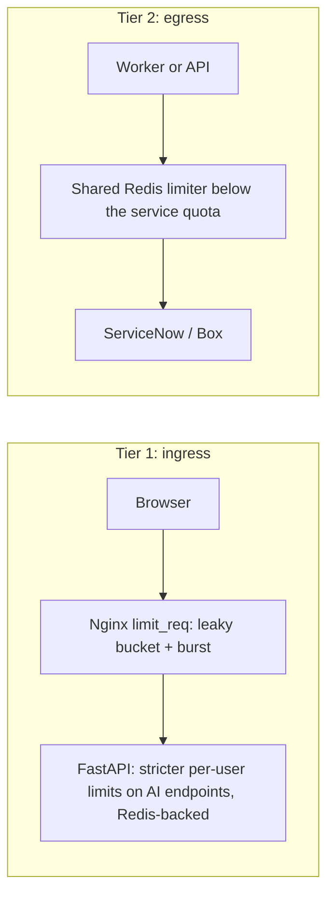

# Rate limiting

**Purpose:** how we limit traffic in two tiers: into our app (ingress) and out to ServiceNow and Box (egress).

**Related ADRs:** [0019 two-tier rate limiting](../adr/0019-rate-limiting.md), [0011 Nginx](../adr/0011-nginx.md), [0020 resilience](../adr/0020-resilience.md), [0010 background worker](../adr/0010-background-worker.md)

Last updated: 2026-10-08. Not built yet.

## The four algorithms

- **Token bucket:** a bucket of N tokens refilling at a steady rate; each request takes one; empty means rejected. Allows short bursts.
- **Fixed window:** N requests per minute, resetting each minute. Simple but choppy: all N can arrive in one second, then nothing for 59.
- **Leaky bucket:** requests flow out at a fixed, steady rate whatever the arrival speed. Smooth.
- **Sliding window:** a smoother version of fixed window.

## Tier 1: ingress (protects our app from overload)

- Nginx `limit_req` per user or IP. Nginx implements a leaky bucket with a burst allowance, which tolerates short bursts such as a manager refreshing dashboards during a major incident.
- Stricter per-user limits on expensive AI endpoints in FastAPI, stored in Redis (library TODO: `fastapi-limiter` or `slowapi`), so one user cannot saturate the GPU.
- Correction: `fastapi-limiter` stores counts in Redis (not in memory) and limits requests coming **into** our API; it does not limit calls going out ([corrections](../context/corrections.md) item 20).

## Tier 2: egress (protects ServiceNow and Box, and our access to them)

This is the more critical tier.

- Every ServiceNow and Box call goes through a limiter set below that service's quota (quotas TODO from admins). A steady, leaky-bucket style outflow suits background sync.
- Handle HTTP 429 and honour `Retry-After`.
- If more than one process calls the same service, the counter must be shared in Redis; otherwise each process counts separately and traffic multiplies.
- **Why it matters:** an agent loop or retry storm could exceed ServiceNow's limits and get the service account blocked, leaving the app blind until IT unblocks it. Agent loops and retries are therefore also capped ([resilience.md](resilience.md)).
- Only ServiceNow and Box are API integrations; the roughly 30 team tools are links.

## Where each limit is configured

| Limit | Where | Value |
|---|---|---|
| Ingress per IP/user | `infra/nginx/` | TODO |
| AI endpoint per user | FastAPI limiter, Redis | TODO |
| ServiceNow egress | integration client settings | TODO (quota from admins) |
| Box egress | integration client settings | TODO (quota from Box admins) |

## What the user sees when limited

Ingress rejections return HTTP 429 with `Retry-After`; the UI shows a clear message instead of a spinner (fail fast). Egress limiting is invisible to users except through a slower sync and "last synced X ago".

## Use the skill

`add-rate-limit` decides ingress vs egress and requires a test that the limit triggers and recovers.
