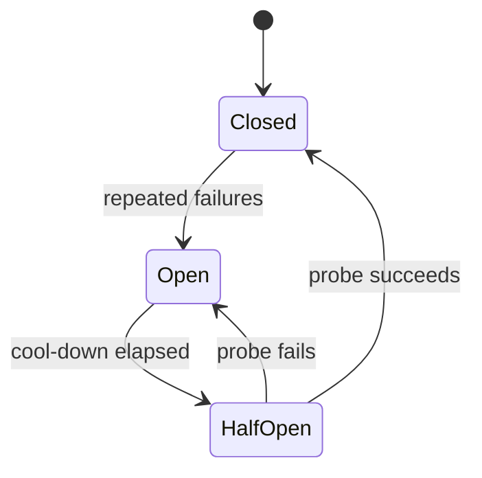

# Resilience

**Purpose:** how the system behaves when things fail: external services, Redis, the worker, the GPU server.

**Related ADRs:** [0020 circuit breakers, timeouts and graceful degradation](../adr/0020-resilience.md), [0010 background worker](../adr/0010-background-worker.md), [0019 rate limiting](../adr/0019-rate-limiting.md), [0007 LangGraph](../adr/0007-langgraph.md)

Last updated: 2026-10-08. Not built yet.

## Patterns (C11.7)

- **Sync engine:** pages read from Postgres and Redis, never live from external systems ([ADR 0010](../adr/0010-background-worker.md)).
- **Timeouts** on every external call.
- **Circuit breakers** on each integration: after repeated failures, stop calling for a cool-down period, serve the last synced data with "last synced X ago" shown in the UI, then probe before resuming.
- **Idempotency** on every write and write-back, so retries never create duplicates.
- **Graceful degradation:** the dashboard keeps working when ServiceNow, Box or the GPU server is down. AI features show a clear "AI unavailable" state; non-AI pages are unaffected.
- **Fail fast:** clear feedback in the UI, never an endless loading spinner.
- **Agent safeguards:** maximum iterations (LangGraph recursion limit), a timeout per node, bounded retries, checkpointing so a failed run resumes, and de-duplication so the same RCA task is never processed twice at once.

## Circuit breaker states

- **Closed:** normal; calls go through, failures are counted.
- **Open:** calls are not made; last synced data is served.
- **Half-open:** one probe call is allowed to test recovery.
Thresholds and cool-down lengths are TODO.

## Retries with backoff

Delays grow after each failure and stop at a limit. 429 honours `Retry-After`. Retrying without limits creates retry storms, which is why retries are bounded and go through the egress limiter ([rate-limiting.md](rate-limiting.md)).

## What each page shows when something is down

| Page | ServiceNow down | Box down | Redis down | GPU / vLLM down |
|---|---|---|---|---|
| Homepage | Last synced data, labelled | Unaffected (mostly) | Loads from Postgres, may be slower | AI shortcuts show "AI unavailable" |
| Environments, Tools, Settings | Unaffected | Unaffected | Loads from Postgres | Unaffected |
| Create RCA list | Last synced data with "last synced X ago" | List loads; uploads queue | Loads; jobs pause | Draft button shows "AI unavailable"; manual editing works |
| Create RCA upload | Unaffected | RCA stays Approved/Uploading; retries; shows Upload failed if exhausted | Queue paused; re-queued from DB status | Unaffected |
| Insights | Last computed data | Last computed data | Loads from Postgres | Last computed data; no new cluster names |
| Search and agent sidebar | Works on synced data | Works on synced data | Works (no cache, limits per policy TODO) | "AI unavailable" |
| Data sources | Connection shown as failing | Connection shown as failing | Loads | Unaffected |

This table is the design target; verify each cell in build plan stage 7.2 (stop Redis, stop the worker, block ServiceNow, stop the GPU server).

## Agent safeguards in detail

LangGraph recursion limit set on every graph; per-node timeouts; bounded retries; checkpointing; a lock keyed by task id (Redis) prevents duplicate runs ([redis.md](redis.md)). A runaway agent loop is also an egress risk: it could exhaust ServiceNow or Box quotas.
