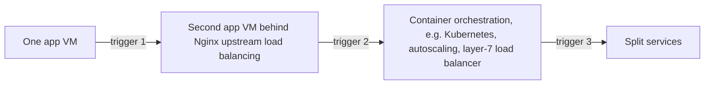

# Scaling

**Purpose:** the statelessness rules that keep scaling possible, and the path we would follow, which is **not built now**.

**Related ADRs:** [0021 stateless backend, scaling deferred](../adr/0021-stateless-backend.md), [0001 modular monolith](../adr/0001-modular-monolith.md), [0011 Nginx](../adr/0011-nginx.md)

Last updated: 2026-10-08

## Statelessness rules

- Backend instances keep **no local state**: sessions, tokens and temporary state live in Redis or Postgres.
- Uploaded files are not stored on the app VM's local disk (storage location TODO).
- Anything that must survive a restart goes to Postgres.
This costs little now and is required before a second instance can ever be added.

## The scaling path (not built now)

| Step | What changes | Trigger (from ADR 0021 and 0001) |
|---|---|---|
| 1. Second app VM | Nginx load balances across two app servers | Sustained latency over the 500 ms target that caching cannot fix |
| 2. Orchestration and autoscaling | Kubernetes or similar | User growth well beyond 1,000 |
| 3. Split services | Extract a module (for example ingestion) | 10x scale, multiple teams, or a component needing independent scaling |

The strategy notes proposed Kubernetes, autoscaling and a layer-7 load balancer from the start; that is deferred ([corrections](../context/corrections.md) item 17). A load balancer is not needed with one app server ([corrections](../context/corrections.md) item 7).
